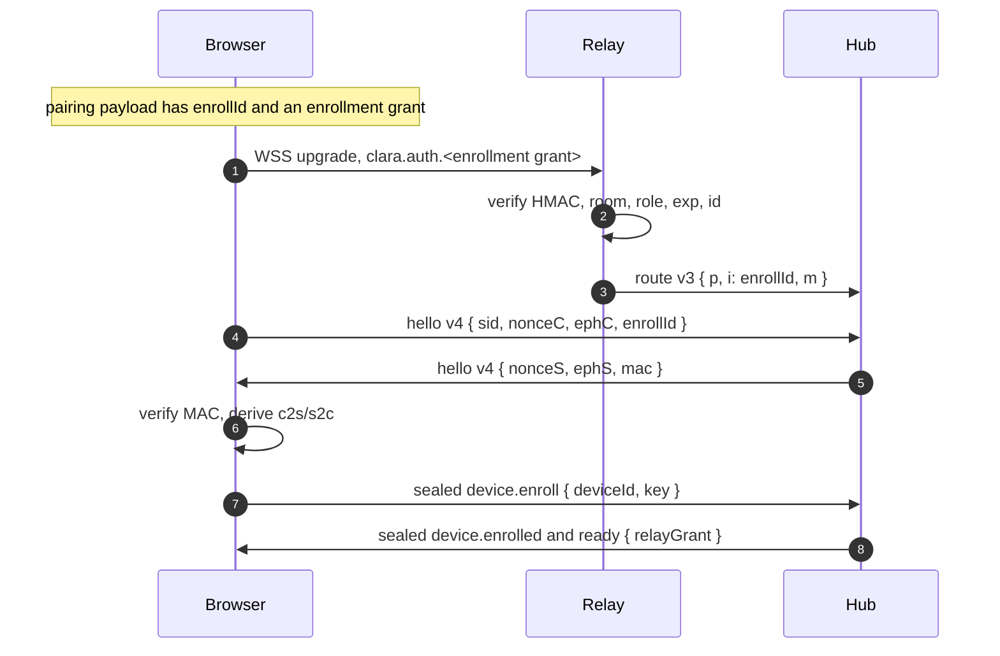
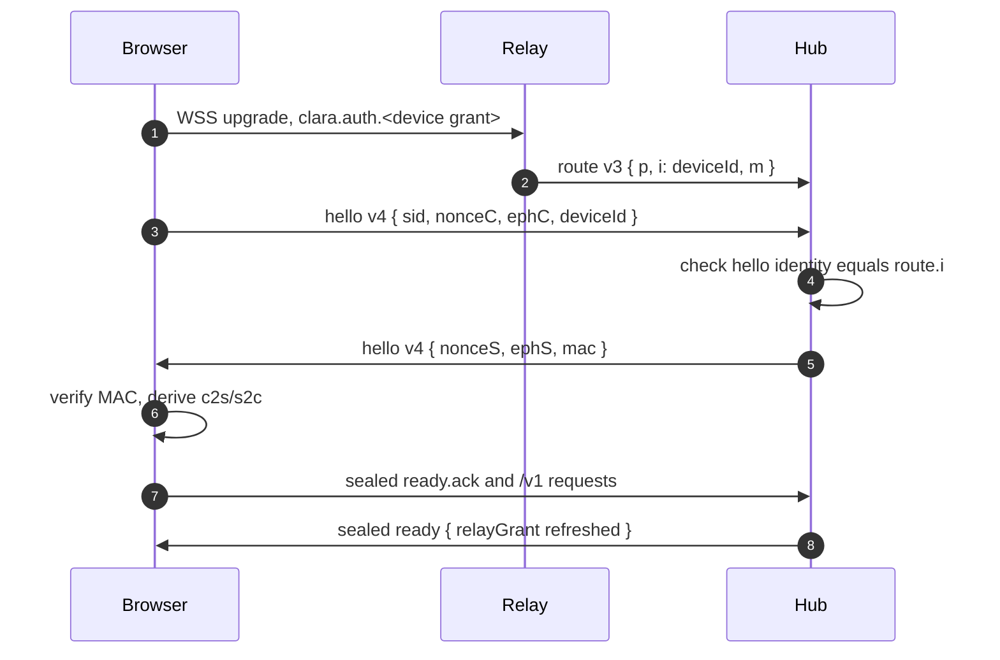
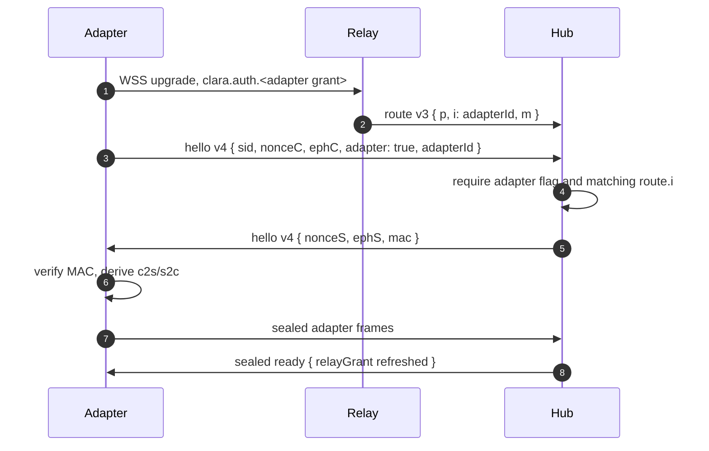

# Handshake v4

## Summary

Handshake v4 replaces the shared relay client token with short-lived signed
grants, adds ephemeral P-256 ECDH for forward secrecy, and authenticates the hub
hello. It ships as one coordinated cutover for the relay, hub, web client, and
adapters; v3 is removed in the same feature, not run alongside v4.

## User flow

1. Update the relay, then the hub, then reload the web client, then update the
   adapters. Every existing device and adapter pairs once more.
2. Pair a browser from the panel or `clara-server pair`. The pairing payload now
   carries a one-time enrollment grant scoped to `enrollId` for ten minutes.
3. The browser connects to the relay with that grant, performs the ECDH hello,
   enrolls its device key, and receives a device grant in the sealed `ready`
   action.
4. On every later connect the browser presents its device grant and receives a
   refreshed grant in `ready`. The grant carries no key material.
5. Pair an adapter from the panel and run the adapter installer. The adapter
   enrolls the same way and receives an adapter grant scoped to its stable
   `adapterId`.
6. Revoke a device or adapter in the panel. The hub stops accepting its
   handshake and stops refreshing its grant; the relay grant expires on its own.
7. A device that has been offline longer than the grant lifetime must re-pair.

## Core business rules

1. Relay access is proved by a grant signed with the agent token. The shared
   client token is gone; the grant names exactly one device, adapter, or
   enrollment.
2. Every session generates fresh P-256 ephemeral key pairs. The static device
   key or adapter credential stays local and is never sent.
3. The hub proves knowledge of the static key by MACing the full transcript in
   its hello. The client verifies it before sending any sealed frame.
4. The hub requires the hello identity to equal the grant id the relay verified
   and attached to the route envelope.
5. Enrollment grants last ten minutes. Device and adapter grants last thirty
   days and are refreshed in `ready` on every accepted connect.
6. The relay advertises route envelope v3. A hub that sees an older relay stays
   offline rather than accepting an untagged peer.

## Edge cases

- An expired grant is refused before the WebSocket upgrade. A grant within the
  60-second clock leeway is accepted.
- A tampered payload, tampered signature, wrong room, wrong role, or missing
  grant is refused with a typed reason.
- A grant id over 128 characters is invalid. So is an empty id.
- A replayed hello fails because `sid` and both nonces are fresh per connection,
  and the MAC covers all of them.
- A hello whose identity differs from the route grant id is dropped before the
  session is registered.
- A relay that reports a route version below 3 makes the hub close the socket
  and report **The relay is outdated; redeploy the Worker**.
- Revocation closes live sessions. An already-issued grant still opens a relay
  socket until it expires, but the hub refuses the handshake and never refreshes
  it.
- A device offline past thirty days cannot reach the hub to refresh and must
  pair again. This is the deliberate cost of a bounded relay credential.
- Clock skew beyond 60 seconds between the hub and the relay looks like an
  expired or not-yet-valid grant.

## Out of scope

- Protecting against a leaked agent token. Its holder can still evict the real
  hub from the room, sign grants, and inject plaintext hub frames.
- Protecting against a compromised hub. The hub holds static keys and live
  ephemeral private keys.
- Relay-side revocation lists or per-device denial at the edge.
- Hardware binding, remote attestation, or post-compromise security.
- Hiding room ids, identities, frame sizes, or timing from Cloudflare.
- A v3 compatibility mode. Local mode keeps speaking bare frames, but its
  session crypto is v4.

## Known gaps

- The client hello has no MAC of its own. The client is authenticated when the
  first sealed action decrypts, because only the holder of the static key can
  derive the session keys.
- The relay cannot revoke a grant before `exp`; revocation is enforced by the
  hub, and access without the static key reveals nothing.

## Threat model delta

| Threat                             | v4 outcome                                                                                                                |
| ---------------------------------- | ------------------------------------------------------------------------------------------------------------------------- |
| Shared relay token leak            | Fixed. Grants are per-id and expire; the shared credential no longer exists.                                              |
| Plaintext hello injection          | Fixed for clients. A forged hub hello cannot produce a valid MAC without the session's static key.                        |
| Harvest now, decrypt later         | Fixed. The static key alone cannot rebuild the ECDH secret or the session keys for a recorded session.                    |
| Cross-peer session poisoning       | Already fixed by the route envelope; v3 keeps peer binding and adds the verified grant id for identity binding.           |
| Agent token leak                   | Not fixed. The holder can replace the hub socket, mint grants, and inject hub frames, though sealed frames stay opaque.   |
| Hub compromise                     | Not fixed. Static keys and live ephemeral private keys are both available to the compromised process.                     |
| Revoked device keeps a relay grant | Partly fixed. It can open a socket until `exp`, but the hub rejects the handshake and stops refreshing; nothing decrypts. |
| Stolen browser storage             | Unchanged. The static key is non-extractable while stored, and one device can be revoked without touching the others.     |
| Metadata exposure                  | Unchanged. The relay still sees the grant id, `sid`, frame sizes, and timing, even though payloads stay sealed.           |

## Technical appendix

<details>
<summary>Frames, byte inputs, sequences, lifecycle, rollout</summary>

### Frames

```json
{
  "t": "hello",
  "v": 4,
  "sid": "…",
  "nonce": "…",
  "role": "client",
  "eph": "<base64url P-256 point>",
  "deviceId": "…"
}
```

```json
{
  "t": "hello",
  "v": 4,
  "sid": "…",
  "nonce": "…",
  "role": "agent",
  "eph": "<base64url P-256 point>",
  "mac": "<base64url HMAC-SHA-256>"
}
```

A browser hello carries `deviceId` or `enrollId`, never both. An adapter hello
carries `adapter: true` with `adapterId`, and may also carry `enrollId` while it
is enrolling. `adapterId` is only valid with the adapter flag. `eph` decodes to
the 65-byte uncompressed point `04 || X || Y`, and `mac` decodes to 32 bytes.
`sid` and `nonce` are base64url values and may not contain `|`.

The relay wraps every client frame:

```json
{ "t": "route", "v": 4, "p": "<peer>", "i": "<grant id>", "b": true, "m": "…" }
```

`i` is the id from the verified grant. `p` is still assigned by the relay, and
`b` still marks base64url bytes. Route envelope v2 had no `i`; v3 is selected by
`x-clara-relay-version: 3` and the hub refuses anything lower. The E2EE version
inside the frame stays independent of the route envelope version.

### Hello key schedule

```text
base    = importSessionKey(staticKey)                  // HKDF base, non-extractable
ecdh    = ECDH(ephPriv, peerEphPub)                    // 32 bytes
transcript = utf8("clara/v4|" + sid + "|" + nonceC + "|" + nonceS + "|" + ephC + "|" + ephS)
salt    = SHA-256(transcript || ecdh)
c2s/s2c = HKDF(base, salt, "clara/v4/c2s" | "clara/v4/s2c") -> AES-GCM-256
macKey  = HKDF(base, salt, "clara/v4/mac") -> HMAC-SHA-256
mac     = HMAC(macKey, transcript)
```

- `ephC` and `ephS` are the exact base64url strings sent on the wire, not decoded
  bytes. `sid`, `nonceC`, and `nonceS` are the exact frame values.
- `||` is byte concatenation with no separator. The transcript already has `|`
  between fields, so the frame guards reject `|` inside `sid` and `nonce`.
- The static key is the HKDF base key so a browser can keep it as a
  non-extractable `CryptoKey` and never export bytes. The ECDH secret goes into
  the salt because the salt does not need to be secret. An attacker who records
  a session and later steals the static key still lacks the discarded ephemeral
  private key, so the salt and the session keys cannot be rebuilt.
- Both sides derive the same `c2s`, `s2c`, and `mac`. A client with the wrong
  static key derives a different MAC and must abort; the hub only accepts sealed
  frames that decrypt.
- `mac` is sent in the hub hello. A client verifies it with
  `verifyV4HelloMac` before sending `ready.ack` or any action.

### Relay grant encoding and verification

```text
payload = {"v":1,"room":"<room>","role":"client","id":"<id>","exp":<unix-seconds>}
```

The encoder writes `v`, `room`, `role`, `id`, `exp` in that order, serializes as
UTF-8 JSON, and base64url-encodes without padding. The signing input is the
encoded payload string as sent, not a re-serialized object. The signature is
`base64url(HMAC-SHA-256(utf8(agentToken), utf8(encodedPayload)))`; the grant is
`<encodedPayload>.<signature>` and travels as `clara.auth.<grant>`.

Verification splits on the single dot, decodes and validates the payload, then
compares the HMAC in constant time and checks `room`, `role`, and
`exp + 60 seconds`. A structurally invalid payload is rejected before the HMAC.
Failure reasons are `malformed`, `invalid_payload`, `bad_signature`,
`wrong_room`, `wrong_role`, and `expired`.

### Grant lifecycle

| Grant      | `id`        | Lifetime | Issued                                      | Refreshed              |
| ---------- | ----------- | -------- | ------------------------------------------- | ---------------------- |
| Enrollment | `enrollId`  | 10 min   | When the pairing code is created            | Never; one connect     |
| Device     | `deviceId`  | 30 days  | Enrollment `ready`, then every accepted one | Every accepted connect |
| Adapter    | `adapterId` | 30 days  | Enrollment `ready`, then every accepted one | Every accepted connect |

A revoked id stops receiving refreshes immediately and its live session ends.
The relay keeps accepting the old grant until `exp`, but without the static key
the socket can only add bounded noise. Grants are not stored at the relay.

### Identity binding

The hub requires the hello identity to equal `route.i`:

- browser device: `hello.deviceId === route.i`;
- browser enrollment: `hello.enrollId === route.i`;
- adapter: `hello.adapterId === route.i` with `adapter: true`;
- adapter enrollment: the grant is scoped to `enrollId`, so
  `hello.enrollId === route.i`; an `adapterId` may accompany it as metadata.

A mismatch is a protocol error. The hub never trusts the hello alone, because
the relay assigned `i` while verifying the grant.

### Sequences

Enrollment:



Device connect:



Adapter connect:



### Relay limits

The relay keys its per-peer frame and byte budgets by grant id, not by the old
shared token. A reconnecting device shares one identity budget, while the room
cap (32 clients), per-IP cap (8), 60 frames/s, 512 KiB/s, and 128 KiB frame cap
are unchanged. A refusal closes with `4008`, or `4009` for an oversized frame.

### Rollout

v4 is the shipped state. There is no compatibility mode, no shared relay client
token, and no `clientToken` field on the wire or in hub configuration.

1. Deploy the relay Worker. It verifies grants, tags `i`, and advertises
   `x-clara-relay-version: 3`. It needs only `CLARA_AGENT_TOKEN`.
2. Deploy the hub. It requires envelope v3, speaks v4 only, and issues grants.
   The panel and Cloudflare deployment store and set only the hub token.
3. Reload the web client. It presents grants and verifies the hub MAC.
4. Update each adapter and pair it once more.

Every existing device and adapter must pair again once to receive a grant. A v3
client or hub is rejected with a protocol error; an old hub refuses to run
against the new relay. The cleanup removed the retired shared token from the
pairing payloads, panel relay fields, sealed credential store, deployment
flow, environment examples, and documentation.

</details>

## Related

- [E2EE](../architecture/e2ee.md)
- [Relay](../architecture/relay.md)
- [Pairing](pairing.md)
