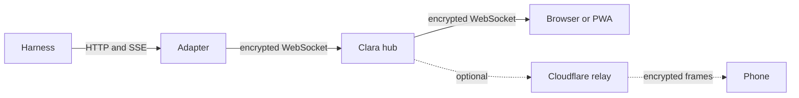

# Self-hosting Clara

Clara has two halves: the **hub** on the machine that runs the hub service, and
the **web client** that devices open. You can run both from one checkout with
Docker or Node, and add the Cloudflare relay only when devices need to connect
from outside your network. A harness adapter connects the harness machine to the
hub.

## What you need

- A machine that can run a harness and its adapter. This release includes the
  OpenCode 2.1.x adapter.
- Node 22 and pnpm 11 for a local install, or Docker with Compose.
- A checkout of this repository.
- Optional: a Cloudflare account and a domain for remote access.

## Choose how to run it

|          | Docker                     | Local                                        |
| -------- | -------------------------- | -------------------------------------------- |
| Best for | A clean, repeatable stack  | Development and existing Node setups         |
| Command  | `pnpm clara start --build` | `pnpm clara start --local --build`           |
| Hub data | Docker volumes             | `~/.config/clara` and `~/.local/share/clara` |
| Web      | nginx on `127.0.0.1:8080`  | Static build on `127.0.0.1:8080`             |

Both modes use the same hub panel, pairing command, and data model.

## The short path

1. Install dependencies with `pnpm install`.
2. Start the stack. Docker is the default; add `--local` for host processes.
3. Open the hub panel and create the owner account. No other hub service starts
   until that account exists. For a headless install, run
   `pnpm clara server setup --password-stdin` instead.
4. The Setup modal asks for the connection path. Choose **Local only** or set up
   the relay with an HTTPS Web URL.
5. Pair a harness in the modal, then run the printed adapter install command on
   the harness machine, or open the link with Clara Desktop to install it in one
   click. Pair a client from the same modal and scan the QR or open the link. You
   can dismiss the modal and resume from **Settings → Setup**. You can also run
   `pnpm clara pair` for a terminal code.
6. Add the web app to your Home Screen or install it.

The detailed steps are in [Docker](docker.md) and
[Local install](local.md).

## Ports

| Service               | Default          |
| --------------------- | ---------------- |
| Web client            | `127.0.0.1:8080` |
| Hub panel             | `127.0.0.1:8790` |
| Hub local WebSocket   | `127.0.0.1:8788` |
| Orchestration service | `127.0.0.1:8789` |
| Clara Lab             | `127.0.0.1:8791` |

The hub panel is loopback-only. Do not expose it to the internet.

The Docker stack keeps fixed container ports. The hub desktop app reuses its
previous panel and local ports and falls back to a free port when one is busy;
the desktop client follows the local port through the hub's runtime file. See
[Hub app](../hub-app.md).

## Where to go next

- [Docker](docker.md)
- [Local install](local.md)
- [Headless server](headless.md)
- [Hub app](../hub-app.md)
- [Configuration](configuration.md)
- [Remote access with the relay](relay.md)
- [Updates and backups](updates.md)
- [Orchestration](orchestration.md)
- [Security and privacy](../security.md)
